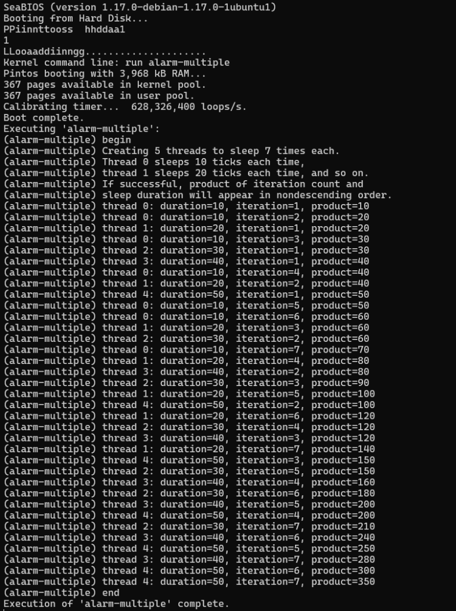

# Pintos Priority Scheduler with Nested Priority Donation

## Project Description
This project implements a strict preemptive Priority Scheduler with nested Priority Donation in the Pintos operating system (x86). The scheduler ensures that the highest-priority ready thread always possesses CPU execution rights. To resolve unbounded priority inversion—where high-priority threads are blocked waiting for locks held by lower-priority threads—the system incorporates recursive (nested) priority donation across multiple lock wait-queues.

## Team Members
- **Mayur R Keni**
- **Hari Prannav**
- **Nitin Yajatkumar**

## Architecture Diagram

```mermaid
stateDiagram-v2
    [*] --> READY: thread_create() / thread_unblock()<br/>(Ordered insertion by priority into Ready List)

    READY --> RUNNING: schedule() / next_thread_to_run()<br/>(Front of Ready List: Highest Priority)

    RUNNING --> READY: thread_yield()<br/>(Preempted by higher priority thread or priority lowered)

    RUNNING --> BLOCKED: lock_acquire() / sema_down()<br/>(Resource unavailable; enqueued in Lock Wait-Queue)

    BLOCKED --> READY: lock_release() / sema_up()<br/>(Unblocked & re-inserted into Ready List by priority)

    RUNNING --> DYING: thread_exit()
    DYING --> [*]

    state RUNNING {
        [*] --> Executing
        Executing --> CheckPreemption: Priority lowered or Higher-priority thread unblocked
        CheckPreemption --> Executing: Still highest priority
    }

    state BLOCKED {
        [*] --> LockWaitQueue
        LockWaitQueue --> DonatePriority: High-priority thread requests held lock
        DonatePriority --> LockWaitQueue: Priority propagated to lock holder (nested)
    }
```

## Baseline Verification
The unmodified baseline Pintos kernel successfully compiles and boots on the x86 simulator (QEMU), passing baseline timer/alarm checks:


