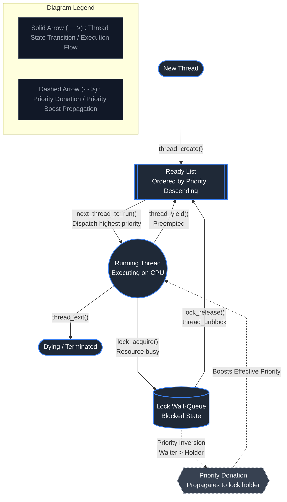

# Pintos Priority Scheduler with Nested Priority Donation

## Project Description
This project implements a strict preemptive Priority Scheduler with nested Priority Donation in the Pintos operating system (x86). The scheduler ensures that the highest-priority ready thread always possesses CPU execution rights. To resolve unbounded priority inversion—where high-priority threads are blocked waiting for locks held by lower-priority threads—the system incorporates recursive (nested) priority donation across multiple lock wait-queues.

## Team Members
- **Mayur R Keni**
- **Hari Prannav**
- **Nitin Yajatkumar**

## Architecture Diagram

